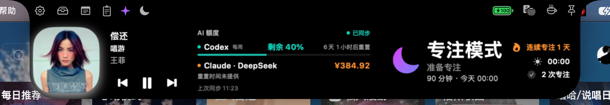
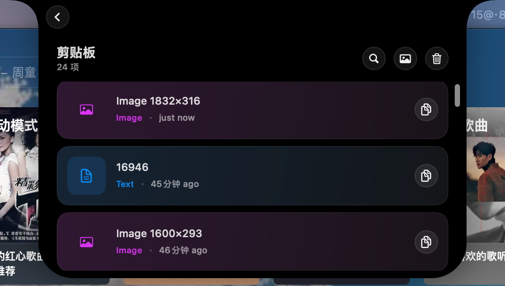

# 💎 Sapphire-CN

🌐 **[项目网站](https://sapphire.u7u7.top/)** · [二开说明与致谢](https://sapphire.u7u7.top/about) · 网站源码位于 [`website/`](website/README.md)。

**Sapphire-CN 是基于 [Sapphire](https://github.com/cshariq/Sapphire) 的二次开发项目**，主要增加中文适配、Codex / Claude 订阅额度与第三方平台余额查询，并修复 Helper 启动连接问题。

本项目由 `u7-u7/Sapphire-CN` 独立维护，非上游官方网站或官方中文版；保留 Shariq Charolia 与上游贡献者署名，许可证见 [LICENSE](LICENSE)。

📦 **[下载 DMG](https://sapphire-cn.oss-cn-hangzhou.aliyuncs.com/releases/v3.0-cn.11-preview/Sapphire-CN-3.0-cn.11-preview-arm64.dmg)** · [ZIP 安装包](https://sapphire-cn.oss-cn-hangzhou.aliyuncs.com/releases/v3.0-cn.11-preview/Sapphire-CN-3.0-cn.11-preview-arm64-update.zip) · [发布说明与校验文件](https://github.com/u7-u7/Sapphire-CN/releases/tag/v3.0-cn.11-preview)

下载优先使用阿里云 OSS 镜像，文件与 GitHub 原包 SHA-256 一致。[GitHub 备用 DMG](https://github.com/u7-u7/Sapphire-CN/releases/download/v3.0-cn.11-preview/Sapphire-CN-3.0-cn.11-preview-arm64.dmg) · [GitHub 备用 ZIP](https://github.com/u7-u7/Sapphire-CN/releases/download/v3.0-cn.11-preview/Sapphire-CN-3.0-cn.11-preview-arm64-update.zip)。CN9 起应用内检查和下载更新优先使用 OSS，失败时回退 GitHub。CN6–CN8 升级 CN11 这一次仍走 GitHub，CN9–CN10 优先使用 OSS，也可从镜像手动安装。

**`v3.0-cn.11-preview` · Apple 芯片 arm64 · 项目最低 macOS 14.6 · 无需 Xcode**

🛠️ CN11 将同应用连续通知合并刷新，单次展示 6 秒，有其他应用等待时连续占用最多 12 秒；新增默认关闭的实验性实时接管入口，传统通知记录模式仍可使用。真实横幅接管与隐藏期间崩溃后的坐标恢复尚未验收，详见[本版说明](docs/releases/3.0-cn.11-preview.md)。

> **升级方式**：CN6–CN10 用户可通过“设置 → 关于 → Sapphire 更新”获取 CN11。CN4 及更早版本、CN5 临时签名版用户需要先退出并备份原应用，再手动安装一次 CN11，迁移到团队 `462JAMGP66`；如 Helper 连接失败，请重新配置辅助服务并检查后台运行权限。

> 📦 通过 DMG 直接安装，无需 App Store。当前为 Apple Development 签名、未公证的开发预览；首次如被拦截，可按下方教程在「隐私与安全性」手动允许。其他 Mac 与整机重启尚未验收。上游原版安装包不含本分支功能。


## 能做什么

| | 功能 |
| --- | --- |
| 📊 AI 额度 | Codex、Claude 订阅额度、同步状态与服务端重置时间 |
| 💰 平台余额 | DeepSeek、Sub2API、NewAPI、自定义 JSON 接口 |
| 🔔 通知上岛 | 前台免打扰、同应用连续消息合并；实验性实时接管默认关闭 |
| 🧩 刘海组件 | 播放信息、日历、组件排序 |
| 🖥️ 桌面工具 | 窗口管理、文件托盘、剪贴板、护眼、电池管理 |
| 🇨🇳 中文界面 | 主要界面与权限说明汉化，少量提示仍为英文 |

部分公开源码为占位实现；订阅、系统扩展等功能需额外配置。

🎵 **音乐、AI 额度与专注，一屏查看**（截图读数仅为示例）



## 通知上岛

在“设置 → 通知”查看连接状态；旧配置可点击“显示所有应用通知”。正在使用来源应用时不重复提醒，切回后清除该应用排队消息。同应用新消息立即刷新当前提醒并重新计时，单次展示 6 秒；有其他应用等待时，当前应用连续展示最多 12 秒后让出位置。

传统通知记录模式仍可使用，需要为 Sapphire 开启完全磁盘访问权限，只读取 macOS 已有通知记录，系统写入记录可能造成延迟。如只想在岛上提醒，可在 macOS“系统设置 → 通知 → 对应应用”取消“桌面”，保留“允许通知”和“通知中心”。退出 Sapphire 后该系统设置仍会保持，新应用需单独设置。

CN11 的实时接管为实验功能，默认关闭。开启时需辅助功能权限，并为来源应用保留原生“桌面”横幅；系统专注模式和屏幕共享静音策略仍然有效，实时模式不会从通知数据库补弹被系统静音的正文。无法确定来源、内容不完整或存在歧义时保留原生横幅；接管失败时恢复原生展示。安装包不自动授予权限或修改系统通知开关。

**真实横幅接管、隐藏期间崩溃后的窗口坐标恢复尚未验收，不能视为稳定功能。** 详细验证范围与限制见[CN11 发布说明](docs/releases/3.0-cn.11-preview.md)。

## 安装包安装

1. **下载**：选择上方 DMG 或应用 ZIP；发布页的 `Source code` 是源码。当前无 Intel 安装包。
2. **安装**：退出并备份旧版。打开 DMG，把 `Sapphire.app` 拖到 `Applications`；ZIP 则解压后复制完整应用。
3. **打开**：启动 `/Applications/Sapphire.app`。如被拦截，到「系统设置 → 隐私与安全性 → 仍要打开」，按提示认证并确认「打开」（[详细步骤](#首次打开被系统拦截)）。
4. **切换中文**：「系统设置 → 通用 → 语言与地区 → 应用程序」添加 Sapphire，选择「简体中文」并重启应用。
5. **打开面板**：按住 **⌘ Command 点击刘海**，点击 ⚙️ 进入设置；默认未开启悬停展开。

安装者无需开发者会员或自行编译。应用显示 `3.0-cn.11-preview`，系统版本为 `3.0 (11)`，发布标签为 `v3.0-cn.11-preview`。

### 首次打开被系统拦截

确认信任来源且[校验一致](#校验下载文件)后，遇到「无法验证开发者」等提示，可按 [Apple 官方说明](https://support.apple.com/zh-cn/102445)操作：

1. 尝试打开 Sapphire，让系统显示拦截提示。
2. 前往「系统设置 → 隐私与安全性」，找到 Sapphire，点击「仍要打开」。
3. 由本人完成系统认证，确认「打开」。

成功允许后，macOS 会保存这份应用的打开例外。辅助功能、Helper 后台运行、钥匙串是另外的授权，按[首次启动与授权](#首次启动与授权)处理。

按钮可能受设备管理策略限制，此流程不保证其他 Mac 可以运行。提示应用损坏或将损坏电脑时，停止打开并按 Apple 说明排查。不要关闭全局安全保护或移除应用签名。

### 校验下载文件

将安装包与 [SHA256SUMS.txt](https://sapphire-cn.oss-cn-hangzhou.aliyuncs.com/releases/v3.0-cn.11-preview/SHA256SUMS.txt) 放在同一目录，在该目录运行：

```sh
shasum -a 256 -c SHA256SUMS.txt
```

已下载的文件应显示 `OK`；只下载一种格式时，另一项会提示文件不存在。

## 首次启动与授权

🔐 跟随引导授权，当前必需项为**辅助功能**；其他权限按功能开启。

| 权限 | 用途与位置 |
| --- | --- |
| 辅助功能 | 窗口管理等；「系统设置 → 隐私与安全 → 辅助功能」 |
| 后台运行 | Helper；「系统设置 → 通用 → 登录项与扩展」（旧系统为「登录项」） |
| 钥匙串 | 剪贴板密钥、查询凭据；本人在系统弹窗处理，单次「允许」后可能再次询问，「始终允许」可选 |
| 日历、通知、位置、蓝牙 | 对应功能使用时授权 |
| 屏幕录制、自动化、完全磁盘访问 | 按窗口预览、媒体控制等功能提示授权 |

需要 Helper 时：**设置 → 电池 → 配置 → 安装**，批准后台运行，等待首次握手（宽限期 30 秒），确认显示辅助服务已运行或 `Helper Active`。首次引导中的按钮叫「安装辅助服务」。

## 基础使用

- **展开面板**：⌘ 点击刘海；可在设置中启用悬停展开。
- **配置组件**：⚙️ → 小组件 → 小组件可见性和顺序，启用并调整排序。
- **其他工具**：在对应分类配置音乐、日历、文件托盘、剪贴板和电池等功能。

📋 **剪贴板历史，快速找回复制内容**



## 配置 AI 额度

📊 在「设置 → 小组件 → 小组件可见性和顺序」启用 **AI 额度**，选择 5 / 15 / 30 分钟刷新。回到面板，点击额度查看详情；手动刷新仍受请求间隔与限流约束。

### Codex 官方订阅

按 [官方教程](https://learn.chatgpt.com/docs/codex/cli)安装 Codex CLI，登录要查看额度的账户：

```sh
codex login
codex login status
```

回到 Sapphire，**关闭 Codex 第三方查询**并刷新。只使用 API 密钥的账户请配置平台查询接口。详见 [OpenAI 认证说明](https://learn.chatgpt.com/docs/auth)。

### Claude 官方订阅

按 [官方教程](https://code.claude.com/docs/zh-CN/setup)安装 Claude Code，再登录：

```sh
claude auth login
claude auth status
```

确认 Claude Code 使用官方服务配置，在 Sapphire **关闭 Claude 第三方查询**后刷新。关闭此开关不会修改 CLI 的供应商配置；登录过期需在 CLI 重新登录。

### DeepSeek 与第三方平台

Claude Code 当前使用 DeepSeek 时会自动识别，也可手动配置。Codex、Claude 各自的第三方设置独立。

1. 在「设置 → 小组件」找到「Codex · 第三方额度」或「Claude · 第三方额度」，开启查询。
2. 填写平台名称、当前供应商 API 地址，选择模板并点击「应用模板」（会重填部分设置）。
3. 核对 **HTTPS 额度查询地址、认证方式、凭据来源**。这里填余额接口；复用 CLI 凭据时，供应商地址须与 CLI 一致；使用独立凭据时，先填写查询密钥或账户令牌。
4. 在「JSON 字段与重置时间」核对字段路径、数值除数和币种；未返回的字段留空。
5. 点击「测试额度查询」，确认读数后点击 **「保存查询设置」**。
6. 使用独立凭据时，再点击 **「保存查询密钥」**，存入钥匙串；随后回到面板刷新。

> 🔑 测试不会保存。独立密钥必须在设置保存后另行保存；修改地址、认证或用户编号后，可能需要重新保存密钥。

| 平台 | 配置要点 |
| --- | --- |
| DeepSeek | 使用可查询余额的密钥；余额不换算成 Claude 订阅百分比 |
| Sub2API | 接口与认证以供应商部署为准，模板地址可能需调整 |
| NewAPI | **账户 Access Token + User ID**，不能用模型 API Key；User ID 虽标可选，此模板实际必填。默认除数 `500000` 须核对 |
| 自定义 JSON | 按真实响应填路径，如 `data.balance`、`balance_infos.0.total_balance` |

币种标签不代表汇率换算；服务端未返回重置时间时显示未提供。

## 常见问题

### Helper 提示 SAP-H1

表示后台已批准但连接失败，不代表进程没启动。依次检查：

1. 等待首次验签，确认后台运行已批准。
2. 确认主程序与 Helper 签名身份匹配，未改成未签名或 ad-hoc 临时签名。
3. 仍无法恢复，再到「设置 → 电池 → 配置」手动「重置辅助服务」。

新版保留等待中的连接，避免短超时触发反复重连。不要连续重置或清空系统后台数据库。SAP-H2 为等待批准，SAP-H3 为文件或注册缺失。

### 钥匙串反复询问或界面卡住

检查是否有系统钥匙串弹窗等待本人处理；单次授权可能在下次启动再次询问。权限已开仍报错时，确认授权对象是当前 `/Applications/Sapphire.app`。

### AI 额度查询失败

| 现象 | 处理 |
| --- | --- |
| 找不到 CLI / 未登录 | 确认 CLI 可运行、登录未过期，再重启 Sapphire |
| 第三方认证失败 | 核对令牌类型、User ID、认证方式与地址 |
| 读不到 CLI 凭据 | GUI 可能读不到终端临时环境变量；持久保存配置或改用独立查询密钥 |
| 测试成功但没更新 | 保存设置及独立密钥，等待刷新或限流冷却 |
| 数值、币种异常 | 核对 JSON 路径、除数与单位 |

## 更新与卸载

「设置 → 关于 → Sapphire 更新」只接收本仓库的公开版本和预发布。CN9 起优先从阿里云 OSS 检查并下载安装包，连接或 HTTP 失败时回退 GitHub；SHA-256、归档、版本和同团队签名校验保持启用。CN6–CN8 升级 CN11 时，旧客户端仍从 GitHub 下载一次。

**CN6–CN10 → CN11 支持应用内更新。** CN4 及更早版本、CN5 临时签名版用户仍需手动安装一次 CN11，迁移更新源与签名团队。完成迁移后，后续同一新团队签名版本可在应用内更新。

应用内下载使用仅包含完整应用的 `-update.zip`；下载后仍需本人点击「安装并重新启动」。自动检查、后台下载和更新通知可在「关于」按需配置。

- **安装包更新**：退出并备份旧版 → 核对新包 → 替换「应用程序」中的应用 → 确认权限、Helper 与额度。
- **源码更新**：工作区无未提交修改时运行 `git pull --ff-only`，使用相同身份重新构建签名后替换。签名变化可能触发重新授权。
- **卸载**：退出后将应用移到废纸篓，按需关闭对应后台项；不用清空钥匙串或系统后台记录。

## 源码安装

🛠️ 需要完整 Xcode、Git 和有效签名身份。主程序、Helper 与嵌入扩展需正确签名；未签名编译不能验证 Helper 可用。

完整命令与签名步骤见 **[开发指南](docs/development.md#源码安装)**。

## 开发与验证

🧪 [开发指南](docs/development.md#开发与验证)包含 Helper 的 14 项 XPC 边界检查与翻译维护说明。

实测记录：[签名修复](docs/plans/2026-10-13-helper-signature-repair.md) · [冷启动修复](docs/plans/2026-10-14-helper-cold-handshake.md) · [发行验证](docs/releases/v3.0-cn.2-preview.md)。

## 来源与许可证

上游项目：[cshariq/Sapphire](https://github.com/cshariq/Sapphire)，感谢原作者与贡献者。本二次开发分支为 [u7-u7/Sapphire-CN](https://github.com/u7-u7/Sapphire-CN)，保留原作者与贡献者署名，遵循 [AGPL-3.0](LICENSE)；第三方资源以各自声明为准。
